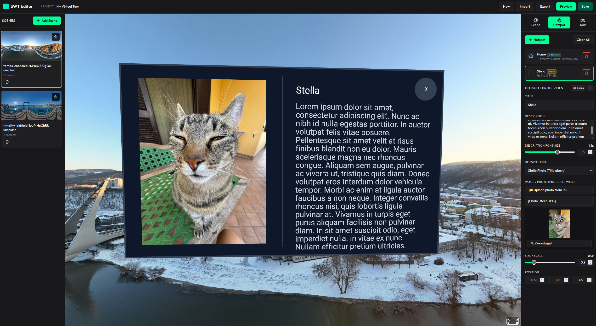
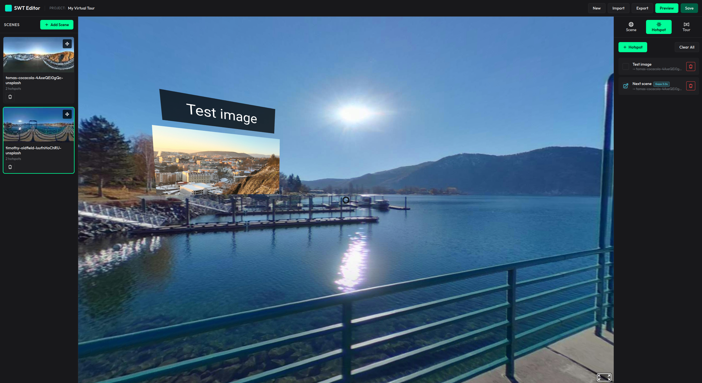
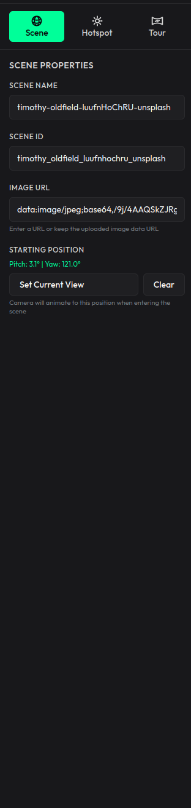
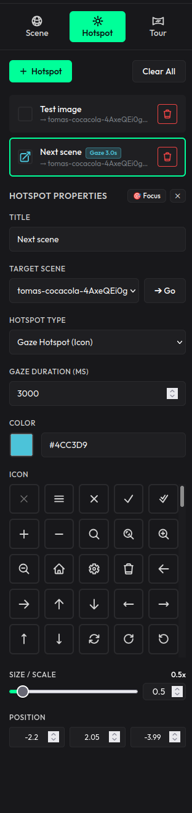
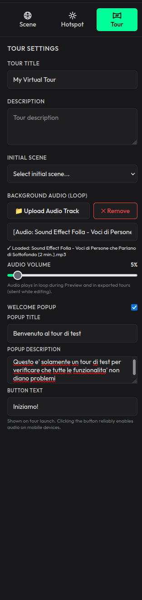
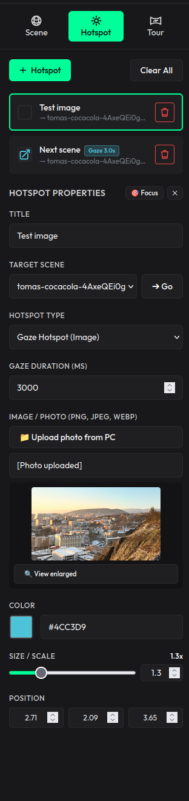
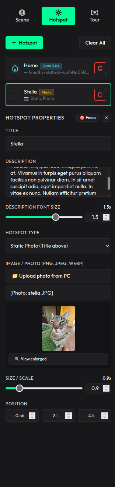

# SenangWebs Tour (SWT)

A powerful, data-driven 360° virtual tour system built on A-Frame WebVR. Create immersive virtual tours using an intuitive visual editor, or embed the lightweight viewer engine into your web projects.

[](LICENSE.md)
[](https://aframe.io/)
[](https://github.com/bookklik-technologies/senangstart-icons)

| In-Scene 3D Photo Card | 360° Gaze Navigation |
| :---: | :---: |
|  |  |

---

## Table of Contents

- [Visual Tour Editor](#-visual-tour-editor)
  - [Interface & Configuration Tabs](#interface--configuration-tabs)
  - [Interactive 3D Hotspot Types](#interactive-3d-hotspot-types)
  - [Key Editor Features](#key-editor-features)
- [Quick Start & Running the Project](#-quick-start--running-the-project)
  - [Option 1: Docker (Recommended)](#option-1-docker-recommended)
  - [Option 2: Local Node.js Development](#option-2-local-nodejs-development)
- [Embedding the Tour (Viewer Library)](#-embedding-the-tour-viewer-library)
  - [Minimal HTML Integration](#minimal-html-integration)
  - [Tour Configuration Schema](#tour-configuration-schema)
  - [Core Methods API](#core-methods-api)
  - [Event Reference](#event-reference)
- [Documentation & Deep Dives](#-documentation--deep-dives)
- [Browser & Device Compatibility](#-browser--device-compatibility)
- [License](#-license)

---

## 🎨 Visual Tour Editor

The visual editor allows anyone to construct complete 360° virtual tours without writing code. Tours are stored locally in the browser (IndexedDB / localStorage) and can be exported as portable JSON or standalone self-contained HTML viewers.

### Interface & Configuration Tabs

The editor organizes properties into three dedicated panels:

| Scene Properties | Gaze Hotspot Configuration | Tour & Audio Settings |
| :---: | :---: | :---: |
| <br><sub><b>Scene Tab</b>: 360° image upload, scene title, and initial camera orientation.</sub> | <br><sub><b>Hotspot Tab</b>: Destination target, countdown timer, icon, color & scale.</sub> | <br><sub><b>Tour Tab</b>: Background audio track, volume slider & welcome popup modal.</sub> |

---

### Interactive 3D Hotspot Types

#### 1. Gaze Image Hotspot (Dynamic Zoom & Scene Transition)

A visual navigation hotspot showing an image preview. When the user looks at the hotspot, the photo smoothly zooms in to fill the entire view before transitioning seamlessly into the destination scene:

| Sidebar Settings | In-Scene 3D View (16:9) |
| :---: | :---: |
| <br><sub>Hotspot type set to <code>Gaze Image</code> with custom preview thumbnail.</sub> | <br><sub>In-scene 3D view with dedicated photo title badge.</sub> |

#### 2. Static 3D Photo & In-Scene Cards

Static photos preserve their natural aspect ratio (16:9, 4:3, 9:16 portrait) in 3D space. Gazing at the photo (or clicking) opens an enlarged in-scene 3D Card (photo on the left, title & formatted description on the right) with a hands-free 2-second gaze timer on the 'X' button to close:

| Sidebar Settings | In-Scene 3D Card View (16:9) |
| :---: | :---: |
| <br><sub>Photo upload, aspect ratio, description & font size slider.</sub> | <br><sub>Enlarged 3D Card in VR with photo details and 2s gaze close timer.</sub> |

---

### Key Editor Features

* **Click-to-Place Hotspots** - Raycast-based placement directly on the 360° spherical canvas.
* **Camera Focus (`🎯 Focus`)** - Smoothly re-orients the 3D viewport directly towards the selected hotspot.
* **Manual Scene Navigation (`➔ Go`)** - Test scene transitions on demand while authoring.
* **Protected Authoring Mode** - Automatic gaze countdowns are deactivated while editing to prevent accidental navigation.
* **Looping Background Audio** - Upload MP3/WAV tracks or paste stream URLs. Features a volume slider (scaled with a safe 35% output ceiling for ambient listening), one-click mute/removal, and automatic preview audio playback.
* **Welcome Popup Modal** - Configurable launch popup ("Start Tour") providing the explicit user gesture required by mobile browsers (iOS & Android) to unlock audio autoplay.
* **Export Flexibility** - Download as portable JSON configuration or export a standalone single-file HTML viewer.

---

## 🚀 Quick Start & Running the Project

### Option 1: Docker (Recommended)

No Node.js or local compiler required. The pre-configured container compiles the production bundles and serves the **Visual Editor directly at the root (`/`)**:

```bash
docker compose up -d --build
```

Open **`http://localhost:8089`** in your browser.

To stop the container:
```bash
docker compose down
```

---

### Option 2: Local Node.js Development

Requires Node.js 18+:

1. **Install and build**:
   ```bash
   npm install
   npm run build     # Compiles bundles into dist/ (0 warnings)
   ```

2. **Start local development server**:
   ```bash
   npm run serve     # HTTP server on http://localhost:8089
   ```
   Open **`http://localhost:8089/examples/editor.html`**.

3. **Start local server with HTTPS** *(for mobile phone testing on Wi-Fi)*:
   ```bash
   npm run serve:https   # HTTPS server on https://localhost:8089
   ```

4. **Run unit tests**:
   ```bash
   npm test          # Runs all 205 automated unit tests
   ```

---

## 📦 Embedding the Tour (Viewer Library)

You can embed virtual tours created with the editor into any existing website.

### Minimal HTML Integration

```html
<!DOCTYPE html>
<html>
  <head>
    <meta charset="UTF-8" />
    <!-- 1. A-Frame (Peer Dependency) -->
    <script src="https://aframe.io/releases/1.7.1/aframe.min.js"></script>
    <!-- 2. SenangWebs Tour Library -->
    <script src="dist/swt.min.js"></script>
  </head>
  <body>
    <!-- A-Frame Scene Container -->
    <a-scene id="tour-scene" loading-screen="enabled: false">
      <a-camera look-controls>
        <a-cursor fuse="false" raycaster="objects: .clickable;"></a-cursor>
      </a-camera>
    </a-scene>

    <script>
      const sceneEl = document.getElementById("tour-scene");
      const tour = new SWT.Tour(sceneEl, tourConfig);
      tour.start();
    </script>
  </body>
</html>
```

### Tour Configuration Schema

Both the editor and the viewer share the exact same JSON format:

```json
{
  "title": "My Virtual Tour",
  "initialScene": "scene-1",
  "audio": {
    "url": "ambient.mp3",
    "volume": 0.5,
    "loop": true
  },
  "welcome": {
    "enabled": true,
    "title": "Welcome to the Tour",
    "description": "Click below to begin exploring with sound.",
    "buttonText": "Start Tour"
  },
  "scenes": [
    {
      "id": "scene-1",
      "name": "Lobby",
      "panorama": "lobby-360.jpg",
      "startingPosition": { "pitch": 0.0, "yaw": 1.57 },
      "hotspots": [
        {
          "id": "hotspot-1",
          "position": { "x": 0, "y": 1.5, "z": -4 },
          "action": {
            "type": "gazeNavigate",
            "target": "scene-2",
            "duration": 3000
          },
          "appearance": {
            "color": "#00ff99",
            "scale": "1.5 1.5 1.5",
            "icon": "arrow"
          },
          "tooltip": { "text": "Enter Main Hall" }
        }
      ]
    }
  ]
}
```

### Core Methods API

| Method | Parameters | Description |
| :--- | :--- | :--- |
| `new SWT.Tour(sceneEl, config)` | `sceneEl`, `config` | Creates a new Tour instance. |
| `tour.start()` | None | Loads the initial scene and starts the tour. Returns `Promise<void>`. |
| `tour.navigateTo(sceneId)` | `sceneId: string` | Smoothly transitions to another scene with fade effect. |
| `tour.getCurrentSceneId()` | None | Returns the active scene ID (`string`). |
| `tour.getSceneById(sceneId)` | `sceneId: string` | Returns the scene configuration object. |
| `tour.playAudio()` | None | Plays the configured background audio track. |
| `tour.pauseAudio()` | None | Pauses the background audio. |
| `tour.setAudioVolume(vol)` | `vol: number (0.0-1.0)` | Sets live audio volume (scaled relative to 35% safe ceiling). |
| `tour.setAudio(audioConfig)` | `audioConfig: Object` | Dynamically updates or removes background audio. |
| `tour.openPhotoModal(data)` | `data: Object` | Opens an enlarged modal dialog for photo hotspots. |
| `tour.closePhotoModal()` | None | Closes the open photo modal dialog. |
| `tour.destroy()` | None | Cleans up all DOM entities, managers, timers, and audio resources. |

### Event Reference

Subscribe to tour events on the `<a-scene>` element using `tour.addEventListener(...)` or `sceneEl.addEventListener(...)`:

| Event Name | Event Detail (`evt.detail`) | Description |
| :--- | :--- | :--- |
| `tour-started` | `{ sceneId }` | Fired when the initial scene has finished loading. |
| `scene-loading` | `{ sceneId }` | Fired immediately before loading a new panorama. |
| `scene-loaded` | `{ sceneId }` | Fired when a scene and its hotspots have loaded. |
| `hotspot-activated` | `{ hotspotData, hotspotId, sceneId }` | Fired when a hotspot is clicked or gaze countdown finishes. |
| `gaze-activated` | `{ hotspotData, hotspotId, sceneId }` | Fired specifically when a gaze countdown successfully completes. |
| `tour-welcome-started` | None | Fired when the user clicks "Start Tour" on the welcome modal. |
| `tour-welcome-closed` | None | Fired when the welcome modal is dismissed. |

---

## 📖 Documentation & Deep Dives

* **[EDITOR.md](EDITOR.md)** — **Custom Editor Development Guide**: Comprehensive documentation for developers looking to build custom editors, use declarative HTML attributes (`data-swt-*`), customize CSS themes, or integrate with custom backend APIs.
* **[SKILLS.md](SKILLS.md)** — Developer cheatsheet, architecture reference, and test suite overview (205 tests).

---

## 📱 Browser & Device Compatibility

| Platform | Navigation Method | VR Headset / Cardboard | Audio Autoplay |
| :--- | :--- | :---: | :---: |
| **Desktop (Chrome, Firefox, Safari, Edge)** | Mouse drag & direct click | Supported (WebXR) | Unlocks on click |
| **Mobile (iOS Safari)** | Gyroscope Look-Controls & touch | Supported (Requires HTTPS) | Unlocks via Welcome Modal / Tap |
| **Mobile (Android Chrome)** | Gyroscope Look-Controls & touch | Supported (Requires HTTPS) | Unlocks via Welcome Modal / Tap |
| **Standalone VR (Meta Quest, Pico)** | Hands-free gaze reticle + controllers | Native WebXR | Supported |

---

## 📄 License

This project is open-source software licensed under the [MIT License](LICENSE.md).
